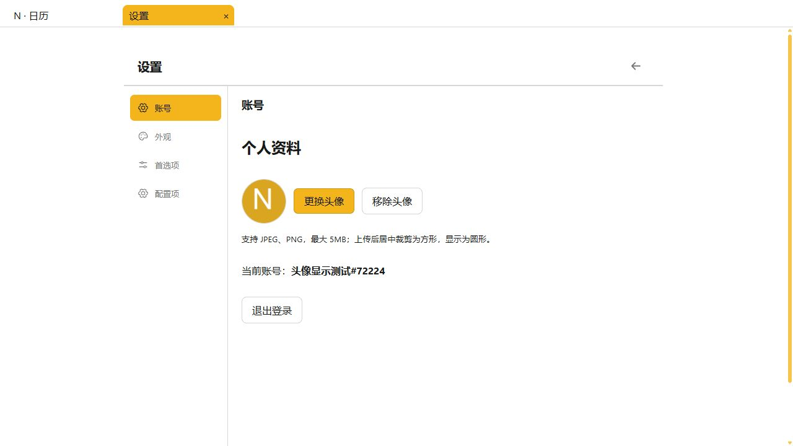

# Note

**把个人计划和群组协作，放进同一张日历。**

Note 是一款支持多人协作的日历与待办应用。用个人空间整理日常安排，用群组共享课程、会议和任务；在年、月、周、日视图间切换，也可以把今天的安排留在桌面小窗中。

<p align="center"></p>
<p align="center">
  <a href="https://github.com/GH-ytym/note/releases/tag/v1.0.0">下载 v1.0.0</a> ·
  <a href="https://124.220.23.245/">打开网页版</a> ·
  <a href="deploy/cloud/README.md">自部署</a> ·
  <a href="https://github.com/GH-ytym/note/issues">反馈问题</a>
</p>

## 开始使用

| 方式 | 入口 | 说明 |
| --- | --- | --- |
| Windows x64 安装版 | [下载安装包](https://github.com/GH-ytym/note/releases/download/v1.0.0/Note-Server-Setup-1.0.0.exe) | 安装到电脑，支持桌面快捷方式与托盘 |
| Windows x64 便携版 | [下载便携版](https://github.com/GH-ytym/note/releases/download/v1.0.0/Note-Server-1.0.0.exe) | 无需安装，直接运行 |
| 网页版 | [打开 Note](https://124.220.23.245/) | 使用浏览器访问同一服务 |
| 自部署 | [部署指南](deploy/cloud/README.md) | 在自己的服务器保存数据，构建连接自己服务的客户端 |

本次桌面包连接 Note 公网服务，使用时需要联网。使用者无需安装 Go、Redis 或数据库。首次注册会创建个人空间；可以通过邮箱或完整的 `用户名#12345` 登录。

1. 在个人空间新建待办或日程。
2. 创建群组，选择自由加入或需要审核，再把六位群号分享给伙伴。
3. 伙伴输入群号即可查看群信息并加入或申请；群主在通知中同意或拒绝。
4. 切换群组，查看共同的安排。每个人独立记录自己的待办完成状态。

v1.0.0 提供 Windows x64 成品包；macOS 尚未提供本版本的验收安装包。Windows 包未进行代码签名，请核对下载来源及 Release 中的 SHA256 校验文件。

## 为日常安排准备的功能

### 一张日历，多种视角

年视图总览日期，月视图查看安排分布，周视图对比一周计划，日视图聚焦今天。日视图支持标签、时间轴和 24 小时时钟，跨天日程会在对应日期展示。

- **待办**：带时间点的事项，支持按日期标记自己的完成状态、查看已完成成员。
- **日程**：有开始和结束时间的活动，适合课程、会议与专注时间。
- **重复安排**：仅一次、每天、工作日、周末、每周、每月及自定义日期。
- **快速改期**：有编辑权限时，可在时间轴或时钟中拖动调整时间。
- **群内搜索**：在当前群组中查找待办与日程。

新建表单在当前日历的右侧展开，选择日期时可直接操作日历。详情、通知和设置通过顶部标签页管理，标签支持拖动排序。

### 个人空间与群组协作

个人空间固定在群组列表首位。群组资料展示群名、群号、加入方式、群主和成员；群图标使用颜色与群名首字符，个人头像可在设置中上传或更换。

群成员可查看群内安排。每条待办／日程分别设置只读或编辑权限，创建者默认可编辑，群主身份不会自动覆盖记录的编辑权限。成员离开后，其创建的安排仍保留在原群中。

### 通知与同步

通知按钮位于侧边栏底部的设置按钮旁。打开后查看最近未读通知，通过“更多”进入完整列表，支持分页、批量已读和通知详情。

入群申请可在通知卡片中同意或拒绝，处理结果同步到申请人。打开通知详情会标记该通知已读；未读数量以服务端为准。

群内日历变更通过实时事件触发更新，并以低频刷新补偿遗漏。通知连接恢复时从数据库重新同步，配合版本检查处理重复和遗漏。网络恢复后客户端会重新校正状态。

### 留在桌面的今日安排

桌面小窗支持标签、时间轴与时钟展示。完整面板与小窗可随时切换，登录后默认进入完整面板。

待办支持系统通知与弹窗提醒。应用运行或驻留托盘时可提醒；完全退出应用后不会继续提醒。设置中可调整主题色、背景、透明度、默认视图和时间轴布局。



## 数据属于哪里

v1.0.0 的协作版使用共享后端：

| 数据 | 存储位置 |
| --- | --- |
| 账号、群组、日程、待办、完成记录、通知 | 服务端 SQLite |
| 登录刷新会话、通知缓存、实时广播 | 服务端 Redis |
| 个人头像 | 腾讯云 COS（也支持服务端本地目录方案） |
| 桌面外观与窗口偏好 | 当前电脑的应用数据目录 |

头像支持 JPEG / PNG，最大 5 MiB；上传后裁剪为 512×512 JPEG。COS 方案仅对头像目录开放读取，上传密钥只保存在后端，不随客户端分发。头像是公开图片，请勿用作私密附件存储。

公网服务适合小规模协作使用，目前没有服务可用性承诺。需要自行控制数据、备份和服务地址时，请选择自部署。

## 自部署

推荐架构为 **Caddy + Go API + SQLite + Redis + COS**，使用 Docker Compose 管理。SQLite 与 Redis 使用持久卷；Caddy 提供 HTTPS；头像直接存入 COS。

```powershell
# 在项目根目录构建 Linux x64 后端及部署文件
./deploy/cloud/build.ps1

# 构建连接自己服务的 Windows 客户端
$env:NOTE_SERVER_URL = 'https://note.example.com/'
npm run dist:server --prefix desktop
```

完整配置、IP HTTPS、头像权限、启动、备份、升级与恢复见 [公有云部署指南](deploy/cloud/README.md)。自部署时必须替换服务地址和密钥，不要直接使用示例凭据。

## 本地开发

需要 Go 1.26+、Node.js 24、npm 和 Redis。前后端分开运行：

```powershell
npm ci --prefix web
npm ci --prefix desktop

# 如果没有本地 Redis
 docker run -d --name note-dev-redis -p 127.0.0.1:6379:6379 redis:8-alpine

$env:NOTE_JWT_SECRET = node -e "process.stdout.write(require('node:crypto').randomBytes(48).toString('base64url'))"
$env:NOTE_DB_PATH = 'data/note-dev.db'
$env:NOTE_REDIS_ADDR = '127.0.0.1:6379'
go run ./cmd/api
```

另开终端执行 `npm run dev --prefix web`，打开终端显示的地址。Vite 默认把 `/api` 转发到本机 8080 端口。持续使用同一个开发数据库时，请保存并复用 JWT 密钥。

```powershell
# 验证源码
 go test ./cmd/... ./internal/...
npm test --prefix web
npm run build --prefix web
npm test --prefix desktop
```

测试命令明确选择业务源码目录，避免本地未纳入 Git 的临时脚本参与构建。全新检出也可运行 `go test ./...`。

| 目录 | 内容 |
| --- | --- |
| `cmd/api`、`internal` | Go API、业务、持久化、通知与日历同步 |
| `web` | React / TypeScript 前端 |
| `desktop` | Electron、窗口管理、提醒与打包 |
| `deploy/cloud` | 公有云 Compose、构建与备份脚本 |
| `docs` | 数据结构、认证与验收文档 |
| `doc` | 开发计划和历史讨论，不作为产品功能承诺 |

技术栈：Go · Gin · GORM · SQLite · Redis · React · TypeScript · Vite · Electron。

## 当前边界

- 指定用户邀请尚未完成；“仅限邀请”群组目前不能通过群号主动加入。新建协作群组建议选择自由加入或需要审核。
- 群解散的通知失效流程尚未完成；已有通知关联的群组会被数据库阻止物理删除，事务回滚并保留数据。
- 修改重复事项时间会影响整个重复规则，暂不支持仅改某一次的时间。
- 旧版 v0.5.0 单机数据不会自动迁入共享服务，升级前请保留原始数据备份。
- 邮箱找回密码、自动更新客户端及大规模容量验证不在本次发布范围内。

## 文档与反馈

- [v1.0.0 发布说明](docs/releases/v1.0.0.md)
- [部署与备份](deploy/cloud/README.md)
- [认证机制](docs/authentication.md)
- [数据库结构](docs/database-schema.md)
- [提交问题](https://github.com/GH-ytym/note/issues)

反馈问题时请附上版本、操作步骤和预期结果；涉及同步问题时说明是否为不同账号、设备或群组。不要提交密码、访问令牌或云服务密钥。

部分界面组件基于 [React Bits](https://github.com/DavidHDev/react-bits)，来源与许可见 [组件说明](web/src/components/react-bits/README.md)。
