<p align="center"></p>
<h1 align="center">Note</h1>
<p align="center"><strong>个人日程与群组待办，共用一张日历。</strong></p>
<p align="center">
  <a href="https://124.220.23.245/"><strong>打开网页版</strong></a> ·
  <a href="https://github.com/GH-ytym/note/releases/download/v1.0.0/Note-Server-Setup-1.0.0.exe"><strong>下载 Windows x64 版</strong></a> ·
  <a href="https://github.com/GH-ytym/note/releases/download/v1.0.0/Note-Server-1.0.0.exe">便携版</a>
</p>

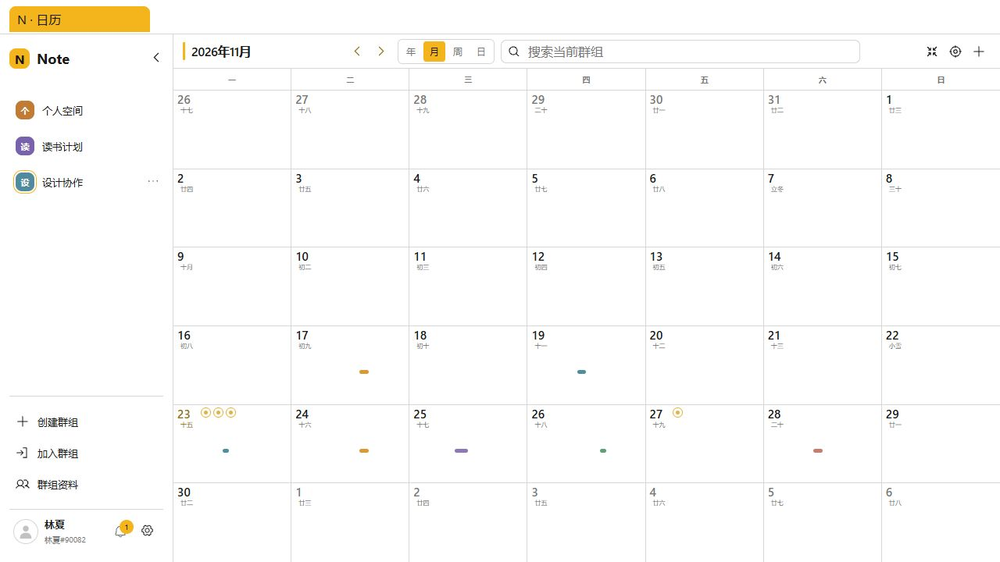

## 从全年看到这一周

排一个学期的课程时，先翻年历找开课日期，再切到周视图。周一到周日并排，每列都是一天的时间轴。两门课之间隔了多久、哪天下午适合约讨论，看它们在格子里的位置就知道。

| 年视图 · 找日期 | 周视图 · 比较每天的安排 |
| --- | --- |
| 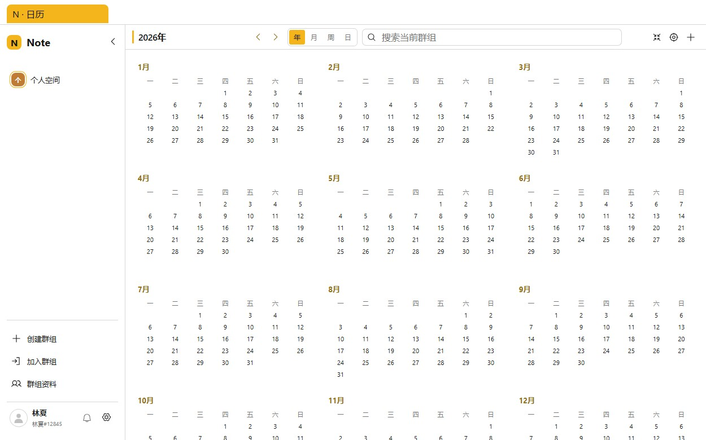 | 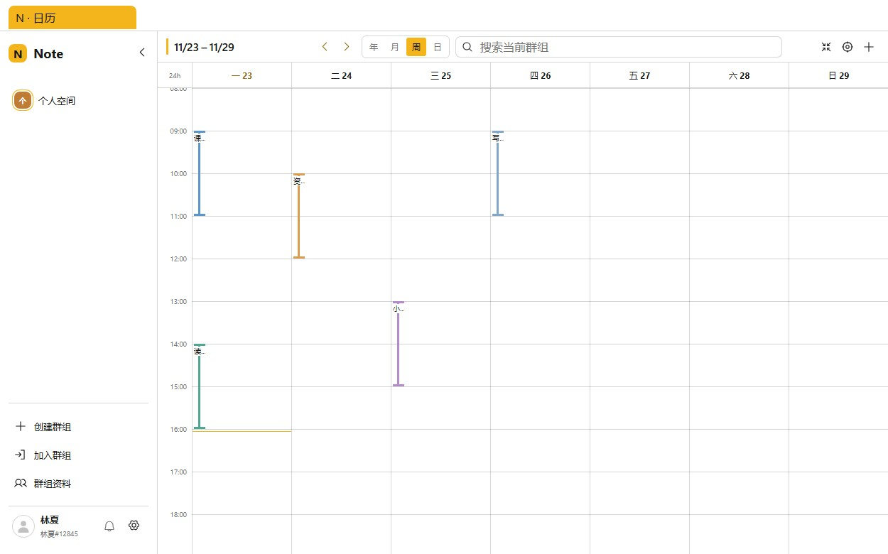 |

## 看看今天还有多少时间

早上打开日历，用清单看今天要做的事。切到 **24 小时时钟**，课程和会议各占一段，空出来的时段也一眼可见。临时改约？在时钟或时间轴上拖动日程，就能调整时间。

| 今日清单 · 做完一项，勾掉一项 | 24 小时时钟 · 看两场会议之间的空档 |
| --- | --- |
| 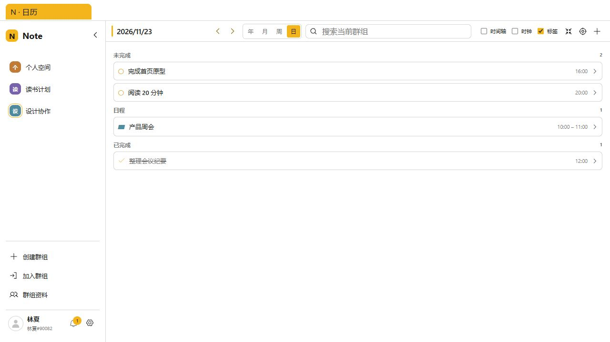 | 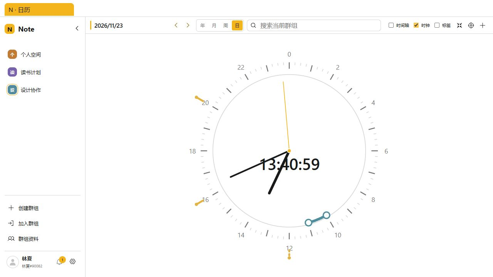 |

## 把日历缩成桌面时钟

在完整日历里排好一天，切到**桌面小窗**，就能把当前时间和下一项安排留在屏幕一角。喜欢逐项查看，可以换成标签或时间轴。要给待办设个提醒，选好提醒时间后，让 Note 驻留托盘即可。

| 日视图 · 沿时间轴查看日程的起止 | 桌面小窗 · 表盘上的色段对应日程 |
| --- | --- |
| 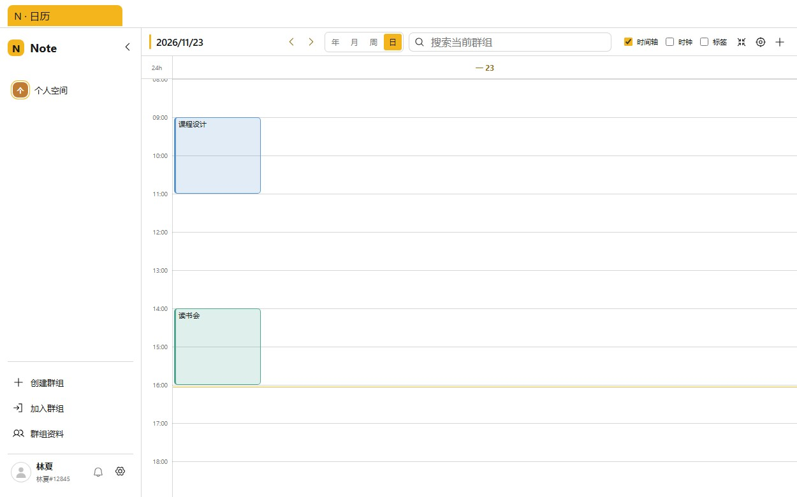 | 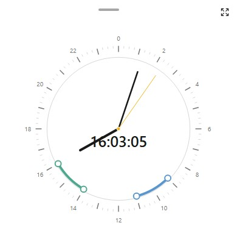 |

## 对着日历，把下次活动定下来

选中周五，在日历旁写下「读书会」，填好开始和结束时间。每周见面，就把日程设为**每周重复**。再添一条「读完第三章」的待办，给自己留一个勾选的位置。

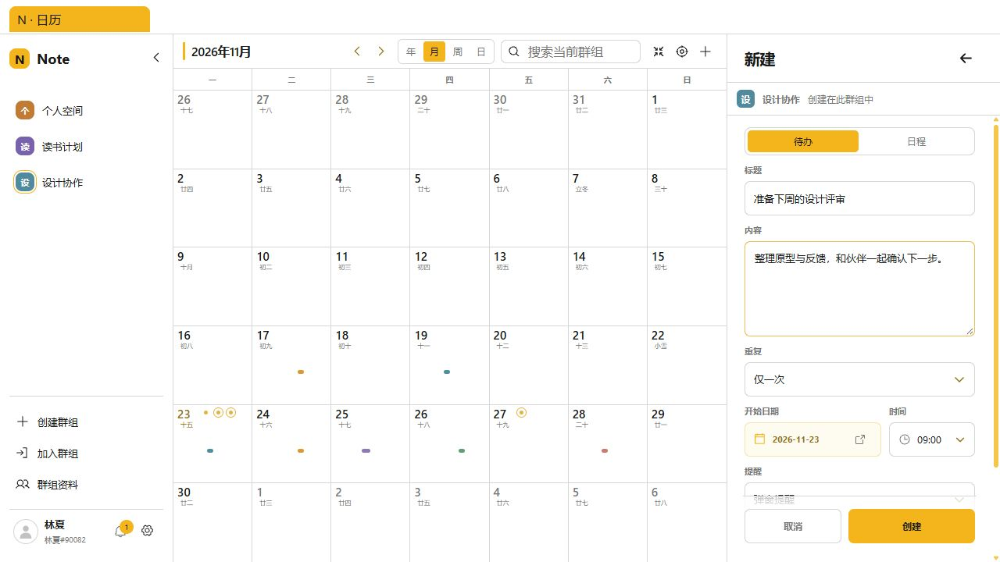

### 在日历上点选日期

**待办**适合有截止时间的事。比如「交初稿」，点「开始日期」，在日历上选周五，再填交稿时间。遇到几次日期各异的排练，把「重复」设为「自定义」，逐个点选排练日，表单会显示已选天数。

**日程**可以跨天。比如周五下午出发、周日中午返程的旅行，先点「开始日期」选周五，再点「结束日期」选周日，两端分别填写时间。

| 待办 · 选择开始日期 | 日程 · 选择结束日期 |
| --- | --- |
| 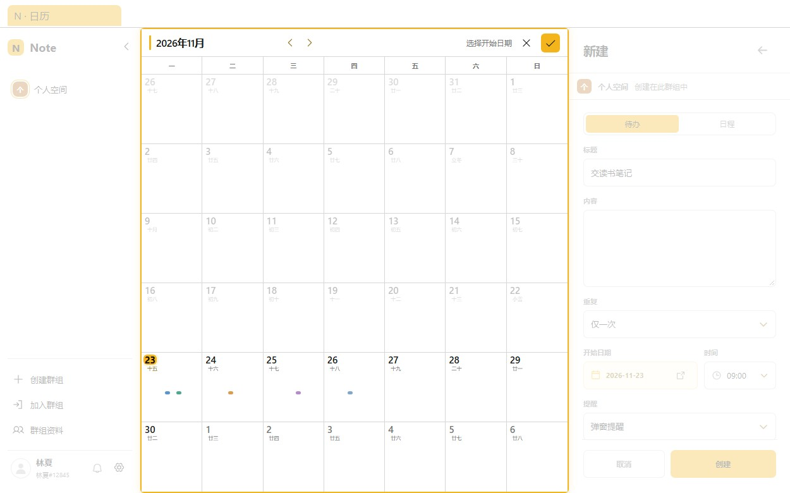 | 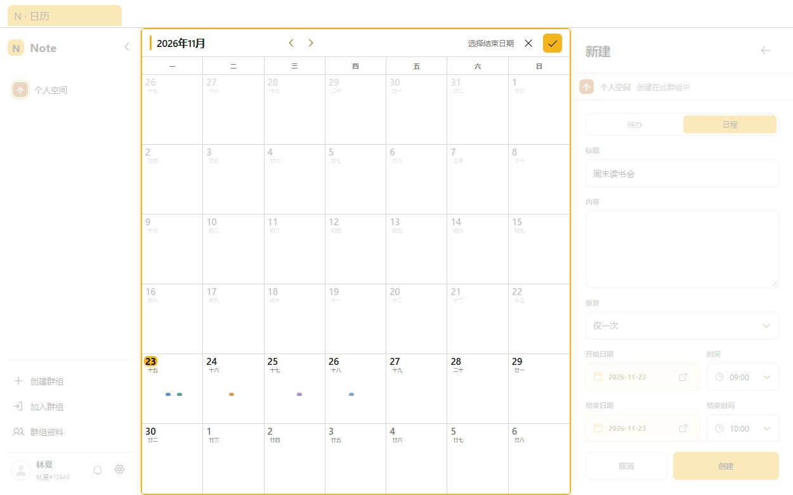 |

## 一起约时间，各自记进度

在个人空间留好自己的阅读时间，再切到读书会群组，把见面时间分享给大家。把**六位群号**发给新伙伴，对方就能找到群组。开启入群审核后，在通知里点一下就能处理申请。

| 分享群号，查看成员 | 在通知里处理入群申请 |
| --- | --- |
| 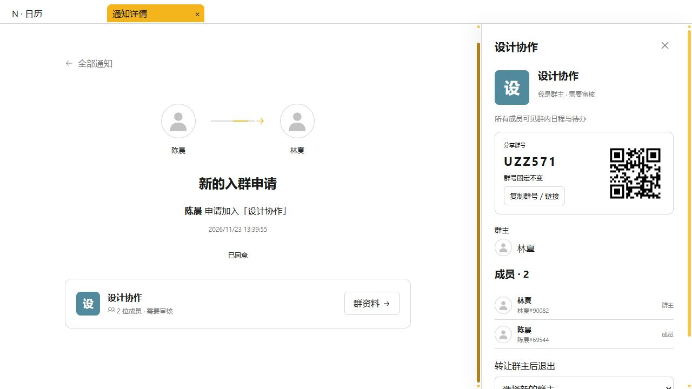 | 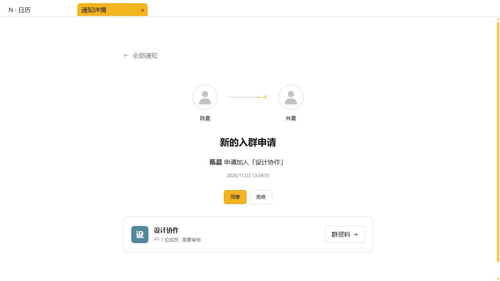 |

共享日程可以交给几位组织者一起编辑，改期后成员的日历会同步更新。共享待办则**每人单独勾选**，打开详情就能看到谁已经读完了这一章。

首次使用时，注册账号即可进入个人空间。网页版和 Windows 版共用账号，换台电脑也能接着安排。[v1.0.0 发布说明](docs/releases/v1.0.0.md) · [使用反馈](https://github.com/GH-ytym/note/issues)

## To Developer

### 本地运行

需要 Go 1.26+、Node.js 24、npm 和 Redis。前后端分开运行：

```powershell
npm ci --prefix web
npm ci --prefix desktop

# 如果没有本地 Redis
docker run -d --name note-dev-redis -p 127.0.0.1:6379:6379 redis:8-alpine

$env:NOTE_JWT_SECRET = node -e "process.stdout.write(require('node:crypto').randomBytes(48).toString('base64url'))"
$env:NOTE_DB_PATH = 'data/note-dev.db'
$env:NOTE_REDIS_ADDR = '127.0.0.1:6379'
go run ./cmd/api
```

另开终端执行 `npm run dev --prefix web`，打开终端显示的地址。Vite 默认把 `/api` 转发到本机 8080 端口。持续使用同一个开发数据库时，请保存并复用 JWT 密钥。

```powershell
# 验证源码
go test ./cmd/... ./internal/...
npm test --prefix web
npm run build --prefix web
npm test --prefix desktop
```


| 目录 | 内容 |
| --- | --- |
| `cmd/api`、`internal` | Go API、业务、持久化、通知与日历同步 |
| `web` | React / TypeScript 前端 |
| `desktop` | Electron、窗口管理、提醒与打包 |
| `deploy/cloud` | 公有云 Compose、构建与备份脚本 |
| `docs` | 数据结构、认证与验收文档 |
| `doc` | 开发计划与历史讨论 |

技术栈：Go · Gin · GORM · SQLite · Redis · React · TypeScript · Vite · Electron。

### 自部署与技术文档

使用 Docker Compose 部署自己的服务，按需配置 HTTPS、头像存储、备份与恢复。构建桌面客户端时，用 `NOTE_SERVER_URL` 指向自己的服务地址。[公有云部署指南](deploy/cloud/README.md) · [认证机制](docs/authentication.md) · [数据库结构](docs/database-schema.md)

部分界面组件基于 React Bits。[组件来源与许可](web/src/components/react-bits/README.md)
